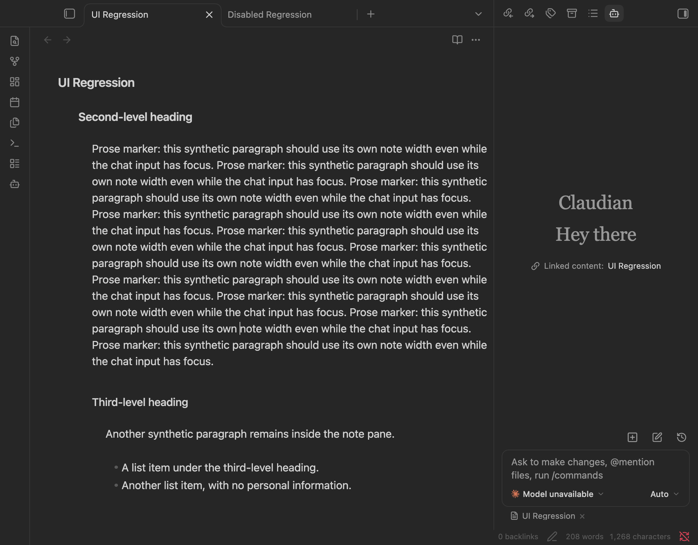
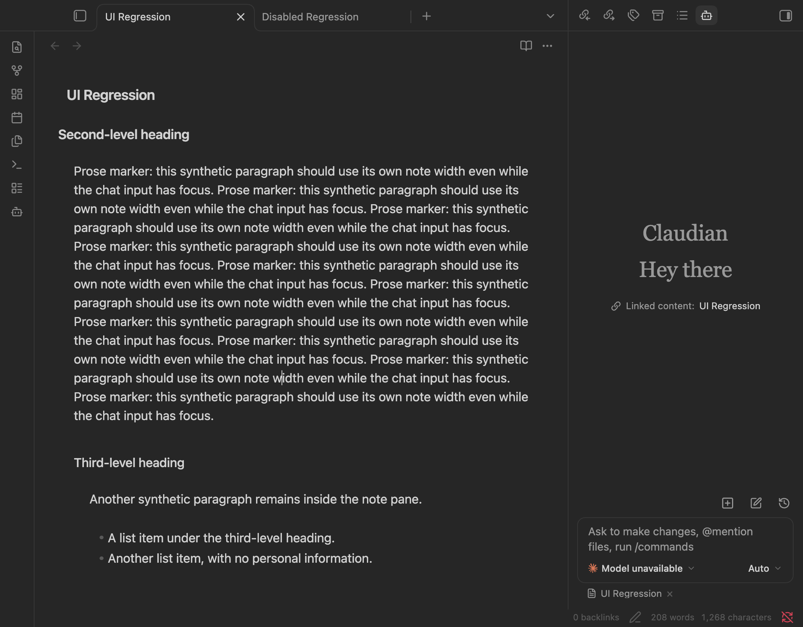
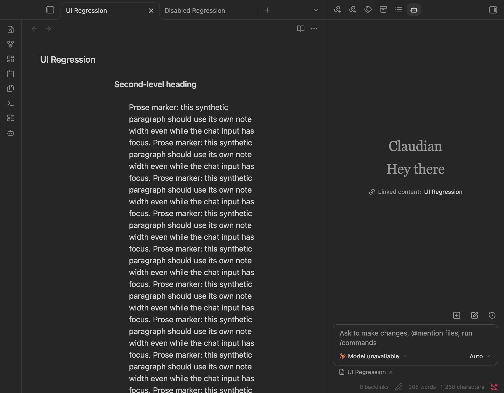
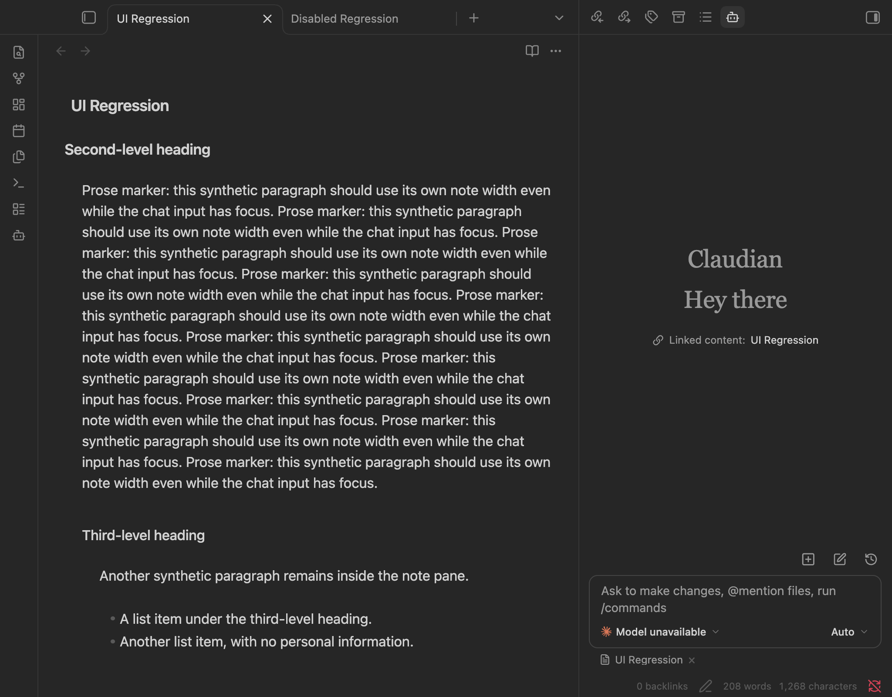
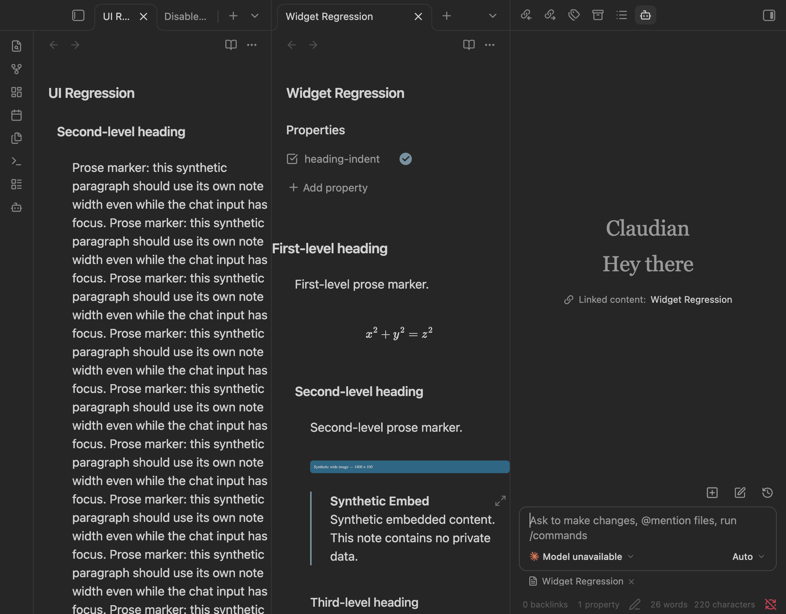
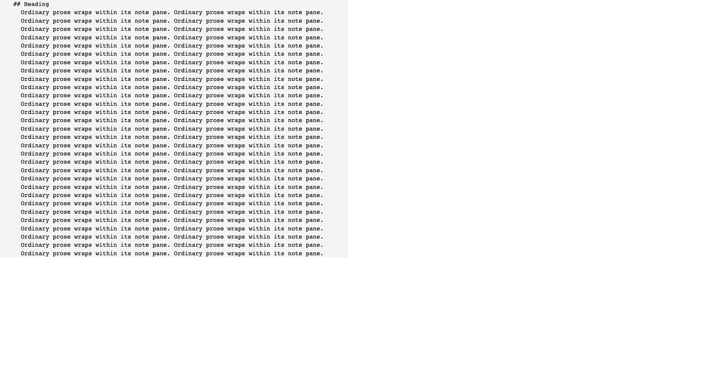
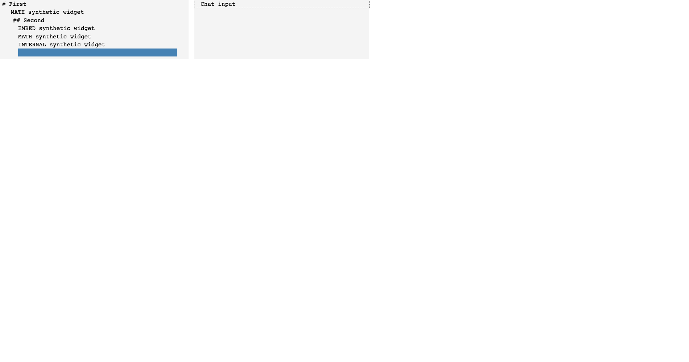

# Committed verification evidence

## 1. Results and provenance

This is a privacy-reviewed subset of the retained local evidence, with synthetic content only. See the [verification record](../../verification-3.0.1.md) for methods, host substitutions, commands and limits.

- Corrected plugin: 3.0.1; actual app: Obsidian 1.14.5 on macOS arm64.
- Actual theme: Minimal 7.7.3; actual chat plugin: Claudian 2.3.36 (`realclaudian`). No model request or sent message.
- Browser suite: 17 tests repeated three times, 51 passes; direction fixture additionally passed ten repetitions.
- Desktop: 16 selected checks passed. `summary.json` aggregates the 11 driver results, three widget checks and two native cleanup checks.
- `final-validation.txt` records a fresh full-suite/lint/typecheck/build pass. `SHA256SUMS` fingerprints every proof file other than itself.

Application screenshots were recaptured after native painting during publication review. Earlier pre-paint captures were not used for this committed comparison. The original 3.0.0 distribution was loaded only in the lab, then the final build was restored and its bytes checked. The captures use matching note/input widths and outer window geometry; a random greeting or tab strip is not part of the geometry assertion.

Text evidence replaces host paths/session identifiers and strips terminal color codes and unrelated Node deprecation-warning lines. The original local artifacts remain private and are not part of the commit. The screenshot pixels are unaltered application captures, not browser fixtures or edited mockups.

## 2. Real application before and after

Minimal, before 3.0.0: 680px content / 709px scroll.

Minimal, final 3.0.1: 680px content / 680px scroll.

Real Claudian input focused, with settings refresh: the original prose shrinks to 284px inside a 620px note box.

The final prose remains 545.59375px wide in the same 620px note box with the same 334px chat input.

Actual math, SVG and note embed in a 310px split content box; no extra scroll width.

## 3. Machine-readable evidence

- `baseline-visible.json` and `fork-final-minimal.json`: measurements paired with the Minimal captures.
- `baseline-chat-refresh.json` and `fork-final-chat-refresh.json`: paired chat-focused measurements.
- `desktop-line-checks.json` / `desktop-driver.txt`: 11 real editing checks and their driver output.
- `desktop-widget-geometry-check.json`, `desktop-widget-metadata-check.json`, `desktop-widget-lifecycle-check.json`: actual renderer geometry, independent metadata and original-style restoration.
- `desktop-reading-enabled.json`, `desktop-reading-disabled.json`, `desktop-reading-cleanup-check.json`: actual reading-view apply/disable/reapply/unload observations.
- `desktop-event-cleanup-check.json`: two actual load/unload cycles return event-reference counts to baseline.
- `desktop-captured-errors.txt`: the application's scoped captured-error buffer.
- `summary.json`: selected checks, versions, matched measurements and final build fingerprint.

## 4. Browser proof, distinct from the application

- `baseline-expected-failures.txt`: original-source failure of both sizing regressions. These two failures are expected, not failures of the final build.
- `event-cleanup-before.txt`: expected pre-fix regression, with a metadata listener left registered.
- `browser-repeated.txt`: 17 tests repeated three times, 51 passes.
- `rtl-stability.txt`: ten passing repetitions of the corrected direction fixture.
- `final-validation.txt`: fresh validation of the final working tree before committing.

The following two images show **browser fixtures**, not Obsidian screenshots. Their host, parser, theme rules and widgets are substituted as described in the verification record.

## 5. Limits

The portable lifecycle tests cover clearing, observers and event ownership; native checks confirm selected real integration behavior. This is not exhaustive reading-view or Markdown compatibility validation. PDF, mobile, older apps and active model execution remain untested. The synthetic vault's settings, vendor distributions, session data, local ZIP and private work logs are intentionally excluded.
